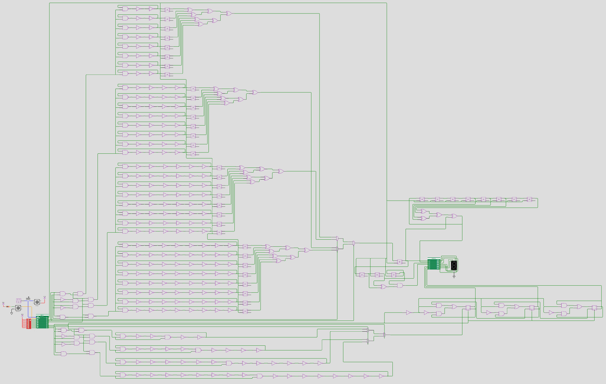

<!---

This file is used to generate your project datasheet. Please fill in the information below and delete any unused
sections.

You can also include images in this folder and reference them in the markdown. Each image must be less than
512 kb in size, and the combined size of all images must be less than 1 MB.
-->

## How it works

This project contains two independent true random number generators (TRNGs) on the same tile. A TRNG produces random bits from a physical noise source, instead of from an algorithm. Here the noise source is the timing jitter of ring oscillators (ROs), which are loops of delay cells (inverters) that oscillate on their own.

The two designs share no input or output pins, so they can run at the same time:

| | Design A | Design B |
|---|---|---|
| Entropy source | Sampled ring oscillators | Multi-edge ring oscillator |
| Inputs | `ui[0:2]` and `clk` | `ui[5:7]` |
| Outputs | `uo[0:3]` | `uo[5:7]` |

### Design A: sampled ring oscillators

Design A has four groups of 8 ring oscillators. The rings in a group have 3, 5, 7 or 9 delay cells. In every ring, one delay cell is a NAND gate instead of an inverter, so the ring can be enabled and disabled with `ui[2]` (it still acts as a delay cell).

- `ui[1:0]` selects which group is used: `00` = 3 cells, `01` = 5 cells, `10` = 7 cells, `11` = 9 cells.
- The 8 rings of the selected group are combined with an XOR tree, which mixes the jitter of all 8 oscillators into a single signal.
- A D flip-flop samples that signal on the clock edge. The sampled bit is the raw TRNG output.

The raw bit is also available after two kinds of post-processing:

- **LFSR whitening**: the raw bits are mixed with a linear-feedback shift register to improve their statistical balance.
- **Von Neumann**: raw bits are compared in pairs. A pair with different values gives an output bit, and a pair with equal values is discarded. A hardware pin cannot skip a bit, so a valid flag tells you when the von Neumann output is usable.

<!-- TODO: check that the von Neumann description matches exactly what the circuit does (which pair gives 0 and which gives 1) and describe the LFSR (length/polynomial) if you want to. -->

Post-processing does not create randomness. It only improves the raw bits, and the quality of all three outputs still depends on the jitter of the oscillators.

| Pin | Name | Function |
|---|---|---|
| `ui[0]`, `ui[1]` | `A_SEL[0]`, `A_SEL[1]` | Select the ring size (3, 5, 7 or 9 cells) |
| `ui[2]` | `A_OSC_EN` | Enables the oscillators (1 = enabled) |
| `clk` | Clock | Samples the XOR-ed oscillators |
| `uo[0]` | `A_TRNG_RAW` | Raw TRNG bit |
| `uo[1]` | `A_TRNG_LFSR` | TRNG bit with LFSR whitening |
| `uo[2]` | `A_TRNG_VN` | TRNG bit with von Neumann post-processing |
| `uo[3]` | `A_TRNG_VN_VALID` | 1 = the bit on `uo[2]` is valid |

<!-- TODO: state the polarity of the enable (ui[2]) if it is not 1 = enabled. -->

### Design B: multi-edge ring oscillator with an edge counter

Design B is a multi-edge ring oscillator: several edges circulate in the same ring at the same time. Edges are injected every 3, 5, 7 or 9 delay cells, selected with `ui[7:6]`: `00` = 3, `01` = 5, `10` = 7, `11` = 9. As in design A, one delay cell in each ring is a NAND gate, used only as an enable.

<!-- TODO: say how long each ring is (in delay cells) and how many edges circulate for each setting, and what "the oscillation collapses" means physically (for example, edges annihilating each other). -->

`ui[5]` controls the measurement:

- `ui[5]` = 1: the oscillator runs and the counter is held in reset.
- `ui[5]` = 0: the oscillator is stopped and the counter starts counting. It counts the edges until the oscillation collapses.

The counter has 3 bits and is built from JK flip-flops. Its final value is the TRNG output, with `uo[5]` as the least significant bit and `uo[7]` as the most significant bit. The count varies randomly from run to run because of jitter.

| Pin | Name | Function |
|---|---|---|
| `ui[5]` | `B_OSC_EN` | 1 = oscillator runs and counter is reset, 0 = oscillator stops and counter counts |
| `ui[6]`, `ui[7]` | `B_SEL[0]`, `B_SEL[1]` | Select the edge injection interval (3, 5, 7 or 9 cells) |
| `uo[5]` | `B_COUNT[0]` | Counter bit 0 (LSB) |
| `uo[6]` | `B_COUNT[1]` | Counter bit 1 |
| `uo[7]` | `B_COUNT[2]` | Counter bit 2 (MSB) |

Pins `ui[3]`, `ui[4]`, `uo[4]` and all `uio` pins are unused.

### Simulation

A digital simulator, such as the one in Wokwi, has ideal gates with no jitter. Do not expect random bits from a simulation. The outputs are only really random on the manufactured chip.

## How to test

The outputs of both designs are also wired to the 7-segment display of the demo board (`uo[0]` is segment A, up to `uo[7]` as the decimal point). Segment E is unused. Because the display is read by eye, set the clock low enough for the bit changes to be visible (a few Hz or lower). If you probe the pins with a scope or a logic analyzer, a much higher clock can be used.

### Design A

1. Select the ring size with `ui[1:0]`.
2. Set `ui[2]` = 1 to enable the oscillators.
3. Apply a clock to `clk`.
4. Watch `uo[0]` (raw) and `uo[1]` (LFSR). New random bits appear at every clock edge.
5. Use `uo[2]` (von Neumann) only when `uo[3]` = 1. Ignore it when `uo[3]` = 0.
6. Change `ui[1:0]` to try the other ring sizes.

<!-- TODO: say whether design A needs a reset or a start-up time after enabling the oscillators. -->

### Design B

1. Select the edge injection interval with `ui[7:6]`.
2. Set `ui[5]` = 1 to start the oscillator (the counter is held in reset).
3. Set `ui[5]` = 0 to stop the oscillator and let the counter count.
4. Wait for the counting to end, then read the 3-bit count on `uo[7:5]` (`uo[5]` is the LSB).
5. Repeat from step 2 to get more samples.

<!-- TODO: say roughly how long to wait in step 4. -->

### Collecting random data

Each sample from design A is one bit per clock edge (the von Neumann output only when its valid flag is 1). Each sample from design B is a 3-bit number per run. To check the quality of the bits, capture a long sequence and analyse it offline.
